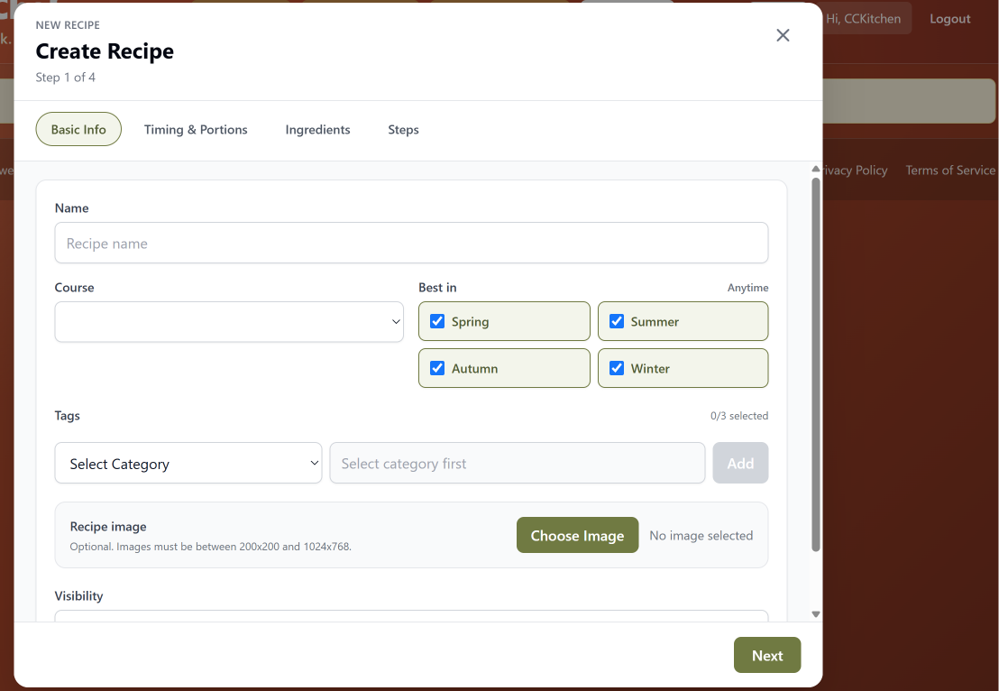
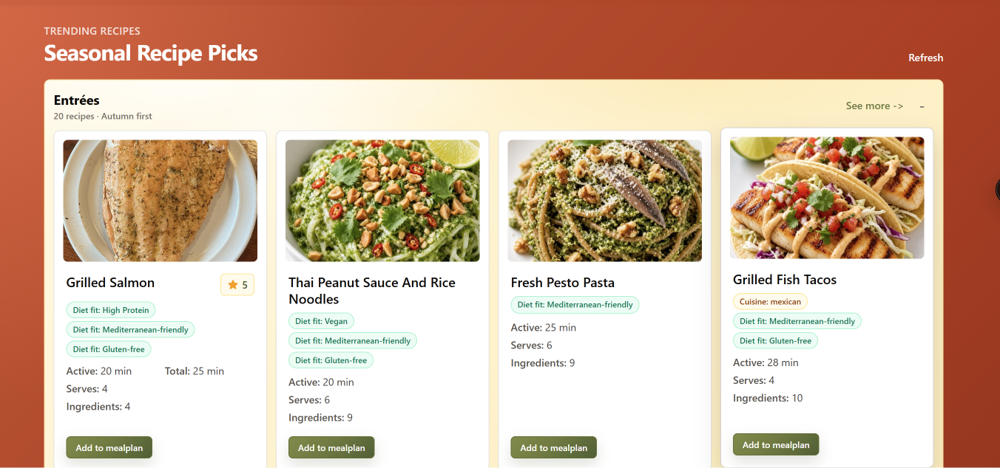
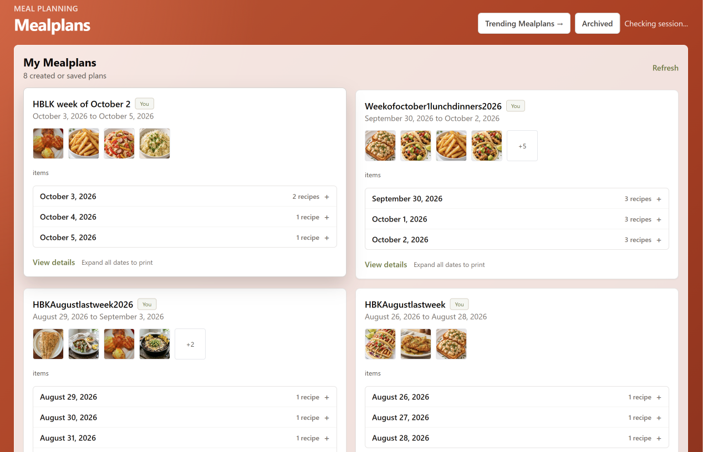
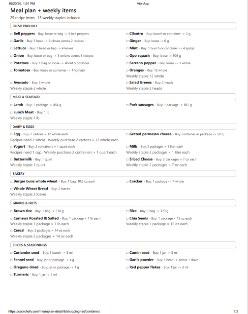

CoolChefy brings recipe management, meal planning, and shopping lists together in one connected workflow. I build websites with clean layouts and a warm, personal feel tailored to each client's audience. For CoolChefy, I focused on making the journey from adding a recipe to preparing a shopping list feel straightforward.

<!--more-->

**Role:** Architect, full-stack developer

**Stack:** Python (Django), Vue.js, Tailwind CSS, Neon Postgres, Vercel/Render, Cloudflare

[Visit the live CoolChefy website](https://coolchefy.com/)

## The workflow

### 1. Add a recipe

The guided form groups recipe details into manageable steps.

### 2. Choose recipes for a meal plan

Recipe cards make it easy to browse ideas and add a recipe to a plan with one click.

### 3. Review the meal plan

The meal-plan overview brings planned recipes and dates together.

### 4. Get the shopping list

The plan can produce a consolidated ingredient list to take from planning to shopping.

